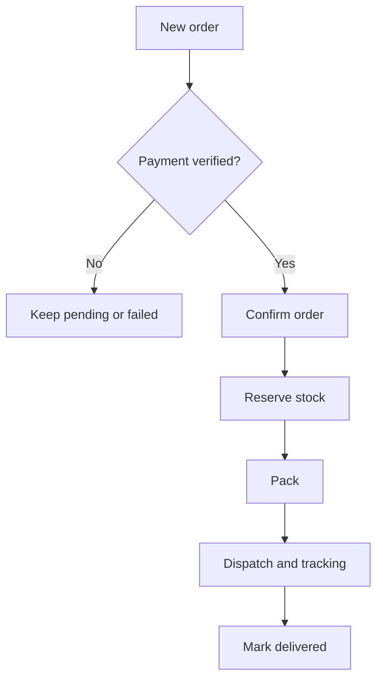

# Nyarko's Hub

**Product Requirements Document**  
Version 1.0 · 26 November 2026  
Prepared by KayTech Africa  
Product type: B2C e-commerce · Primary market: Ghana

Live prototype: https://nyarkos-hub.vercel.app  
Repository: https://github.com/Khobby-Kay/nyarkos-hub

## Vision

A premium, conversion-focused fashion shop where customers can discover and buy products without friction, and the business can run catalogue, stock, orders, payments, and marketing from one admin system.

The shopping experience is inspired by fast-fashion commerce. The visual identity, layout, and brand assets must be original.

## 1. Product overview

Nyarko's Hub lets customers browse, select, and purchase fashion products online.

The platform includes:

- A visually engaging storefront
- Searchable, filterable catalogue
- Product pages with images, sizes, colours, and stock
- Cart and secure checkout
- Mobile Money and card payments
- Customer accounts
- Order processing and delivery tracking
- Inventory management
- Promotions and discounts
- An administrative dashboard

### Objectives

1. Give Nyarko's Hub a professional online presence.
2. Let customers buy at any time.
3. Make product discovery simple.
4. Reduce manual order handling.
5. Confirm payments and send order notices automatically.
6. Show accurate stock.
7. Bring customers back with relevant offers.
8. Give the business sales and customer insight.
9. Support a larger catalogue and more traffic.
10. Allow expansion beyond Ghana later.

### Success metrics

| Metric | Measurement |
| --- | --- |
| Sales | Completed order value |
| Conversion rate | Visitors who purchase |
| Average order value | Revenue per completed order |
| Cart abandonment | Carts that do not convert |
| Repeat purchase rate | Customers who buy more than once |
| Product performance | Sales by product |
| Customer acquisition | New customers |
| Payment success | Successful payments vs attempts |
| Order fulfilment | Orders delivered |
| Inventory accuracy | Recorded stock vs actual stock |

Administrators must see these metrics in the dashboard.

## 2. Users

Initial market: online fashion shoppers in Ghana. Architecture must allow international customers later.

**Shoppers:** general, returning, and mobile-first customers.  
**Staff:** Super Administrator, Store Manager, Inventory Manager, Sales Manager, Customer Support. Permissions are role-based and enforced on the server.

## 3. Systems

- **System A — Storefront:** public site for discovery, purchase, and account activity.
- **System B — Admin:** private dashboard for products, orders, payments, inventory, customers, marketing, and content.

Both use one backend and one database.

## 4. Storefront requirements

### 4.1 Homepage (HP-01 to HP-14)

Announcement bar, responsive header with logo and search, hero, new arrivals, best sellers, featured categories, trending products, promotional collections, shop the look, reviews, social gallery, newsletter, and footer.

- Homepage content is editable in admin.
- Banners support image and video and can be scheduled.
- Product sections use live catalogue data.
- Product cards link to product pages.
- Sections can be reordered and hidden.
- Layout adapts to phone, tablet, and desktop.

### 4.2 Categories and collections

Administrators create categories, subcategories, and collections. A product can sit in more than one collection. Menus, category banners, and descriptions are configurable.

Proposed catalogue groups (not all required at launch): women's, men's, children's, dresses, tops, jeans, skirts, jumpsuits, sets, shoes, bags, accessories, jewellery, beauty. Collections: new arrivals, best sellers, trending, back in stock, featured, seasonal, sale, clearance.

**Launch catalogue, already confirmed by the client:** six men's knit polos only, until Nyarko's Hub approves more categories.

### 4.3 Catalogue (CAT-01 to CAT-10)

Responsive grid. Each card shows image, name, selling price, original price, discount, colour swatches, badges, wishlist, and quick add when the variant can be chosen safely.

Search, category, price, size, colour, and availability filters. Sort by price, popularity, and newest. Quick view, quick add, and pagination. Empty search states must be useful.

### 4.4 Product detail page

Title, SKU, description, images, optional video, price, sale price, sizes, colours, fabric, size guide, stock, care, delivery, and return eligibility.

Actions: choose colour and size, quantity, wishlist, add to cart, buy now, share, related products, complementary products, recently viewed, and reviews after a verified purchase.

Rules:

1. Unavailable variants cannot be purchased.
2. Each size and colour combination has its own stock record.
3. Prices come from the backend.
4. Multiple image views are supported.
5. Sizing information is product-specific.
6. Stock on the page updates when inventory changes.

### 4.5 Cart

Add, remove, change quantity and variant, show images and line prices, subtotal, discount codes, shipping, order total, save for later, and estimated delivery. Cart persists across navigation and, for signed-in customers, across sessions. Prices, discounts, and stock are validated again before checkout.

### 4.6 Wishlist

Add, remove, view, move to cart. Registered customers can be notified when a saved product is restocked, if they consented. Guests may keep a wishlist in the browser.

### 4.7 Accounts

Register, email and password, Google sign-in, logout, password recovery, email verification, profile, saved addresses, and account-deletion request. Guest checkout is required. An account is not required to buy.

### 4.8 Checkout

Stages: contact, address, delivery method, summary, payment, processing, confirmation.

Collect name, email, phone, region, city, address, and delivery notes. Support guest and signed-in checkout, address selection, shipping cost, discount checks, tax if configured, payment start and verification, and an invoice. Repeated payment callbacks and refreshes must not create duplicate orders.

### 4.9 Payments

Initial methods for Ghana:

| Method | Integration |
| --- | --- |
| MTN Mobile Money | Paystack or Hubtel |
| Telecel Cash | If the chosen provider supports it |
| AT Money | If the chosen provider supports it |
| Visa and Mastercard | Same payment gateway |
| Cash on delivery | Optional, turned on by the business |

Requirements: secure initiation, transaction reference, server-side verification, signed webhooks, status updates, failure handling, retry, refund records, history, and reconciliation.

Payment states: pending, processing, successful, failed, cancelled, refunded, partially refunded.

An order is paid only after the provider confirms the transaction.

### 4.10 Customer orders

Confirmation, reference, line items, payment status, fulfilment status, tracking, history, invoice download, enquiries, and return or exchange requests. Guests track with an order reference plus a verification detail such as phone or email.

### 4.11 Delivery

Configurable options: Accra, regional Ghana, nationwide, pickup, and international when enabled.

Admins set charges, zones, free-delivery thresholds, estimates, providers, statuses, tracking numbers, and completion. The customer sees the delivery charge before paying.

### 4.12 Reviews

Stars, written review, photos, verified-purchase badge, moderation, admin replies, and reporting. Verified badges require a completed purchase of that product.

### 4.13 Support

WhatsApp button, contact form, FAQ, order enquiry, returns form, support email, and optional live chat. Enquiries attach to an order when one exists.

## 5. Admin requirements

Protected route, separate from the storefront.

### 5.1 Overview

Revenue, orders by status, customers, new customers, average order value, best sellers, low stock, recent transactions, sales chart, revenue by period, and order-status mix. Filter by date range.

### 5.2 Products

Create, edit, archive, publish, unpublish, images, video, descriptions, prices, sale prices, SKUs, categories, collections, tags, variants, sizes, colours, stock, availability, and scheduled publish. States: draft, published, archived.

### 5.3 Inventory

Stock is per variant. Confirmed purchase reduces stock. Eligible cancellation restores it. Low-stock alerts, out-of-stock handling, manual adjustments, movement history, reports, and no overselling. Stock changes use a database transaction so two customers cannot buy the last unit.

### 5.4 Orders

List, search, filter by date, customer, payment, and fulfilment. View detail, change status, internal notes, assign delivery, tracking, cancel, refund, print invoice, export. Keep a history of status changes.

### 5.5 Customers

Profiles, purchase history, contact details, lifetime spend, search, filters, segments, repeat buyers, and enquiries. Sensitive fields are limited to authorized roles.

### 5.6 Promotions

Percentage, fixed amount, product, category, order-wide, first purchase, minimum spend, bundle, free delivery, and time-limited campaigns. Rules include code, value, dates, usage limit, minimum order, eligible products and categories, customer eligibility, and optional maximum discount. The server validates every promotion.

### 5.7 Content

Banners, hero media, featured products and collections, category images, section visibility and order, announcements, footer, FAQ, about, contact, privacy, terms, shipping and returns, and journal articles. No code deploy required for these edits.

### 5.8 Marketing

Newsletter list, segments, campaigns, coupons, abandoned-cart records and reminders, restock notices, and order and delivery messages. Messages follow consent and Ghanaian data-protection rules.

### 5.9 Reports

Revenue, sales, product, category, inventory, acquisition, repeat purchase, payments, refunds, abandoned carts, and delivery. Export CSV or Excel.

### 5.10 Staff

Roles: Super Administrator, Store Administrator, Sales Manager, Inventory Manager, Order Manager, Customer Support Agent, Marketing Manager. Permissions are configurable and enforced on the server. Sensitive actions are written to an audit log.

## 6. Retention

### Abandoned cart

Record a cart when a known customer leaves checkout unfinished, schedule a reminder, and link them back to that cart. Admins set timing and templates.

### Transactional messages

Welcome, order placed, payment success, payment failure, processing, dispatch, out for delivery, delivered, refund, and restock. Email first. WhatsApp and SMS when a provider is approved.

### Newsletter segments

New, returning, high-value, inactive, frequent, and category interest. Campaigns should report delivery, clicks, and conversions when the provider supports it.

## 7. Later shopping features

| Feature | Release |
| --- | --- |
| Recently viewed | MVP |
| Recommendations, shop the look, back-in-stock, loyalty, gift cards | Phase 2 |
| AI style assistant, visual search, outfit builder, affiliates | Phase 3 |

These are not launch dependencies.

## 8. Journeys

Guests can buy without an account, receive a reference, and track the order with a verification detail. After purchase they may be invited to register.

## 9. Design

Combine a commercial product grid with editorial presentation. Do not copy Fashion Nova branding, photography, or layout.

| Element | Direction |
| --- | --- |
| Primary | Black |
| Background | Off-white |
| Secondary | Warm beige |
| Accent | Client to confirm. Prototype uses coral `#e63946` |
| Type | DM Sans for text, Syne for display |
| Photography | High-resolution product imagery |
| Layout | Spacious, mobile-first |

Mobile needs navigation, search, cart, filters, size and colour selection, a sticky add-to-cart on the product page, and a short checkout. Motion stays subtle and must not block shopping or accessibility.

## 10. Technical direction

| Layer | Choice |
| --- | --- |
| App | Next.js, React, TypeScript |
| Styling and motion | Tailwind CSS, Framer Motion |
| Data | PostgreSQL via Supabase |
| Auth | Supabase Auth |
| Files | Supabase Storage or Cloudinary |
| Payments | Paystack or Hubtel |
| Email | Resend or equivalent |
| WhatsApp | Approved Business API provider |
| Analytics | Google Analytics 4 |
| Search | PostgreSQL full text at launch |
| Hosting and source | Vercel and GitHub |

Sensitive work runs on the server. The current prototype keeps products in `src/lib/data.ts` and has no database yet.

Core tables: users, customer_profiles, addresses, products, categories, collections, product_images, product_variants, inventory, inventory_movements, carts, cart_items, wishlists, wishlist_items, orders, order_items, payments, refunds, shipping_methods, shipments, coupons, promotions, reviews, notifications, newsletter_subscribers, support_tickets, admin_roles, audit_logs.

Relationships: customers have many addresses and orders. Orders have many items and payment attempts. Products have many images and variants. Each variant has one inventory record. Products can belong to many collections. Payments and refunds reference orders. Staff permissions and audit logs are separate from customer data.

Product fields include id, name, slug, SKU, description, category, tags, regular price, sale price, currency, images, status, variants, stock, material, dimensions, SEO title and description, and timestamps. Variant SKUs and stock are independent. Launch currency is GHS.

## 11. Security

Secure auth and password hashing, role checks on the server, row-level data access, input validation, injection and XSS protection, CSRF protection where relevant, signed payment webhooks, rate limits, secure sessions, audit logs, backups, and secrets in environment variables. Do not store card numbers or CVV. Handle customer data under Ghana's data protection rules.

## 12. SEO and marketing tags

Friendly URLs, sitemap, robots.txt, canonical URLs, product and breadcrumb structured data, Open Graph, titles, descriptions, alt text, and Search Console. Content pages: categories, journal, guides, and internal links.

Integrations: GA4, Tag Manager, Meta Pixel, optional Google Ads, email, and WhatsApp. Tracking waits for consent where required.

## 13. Performance

| Target | Value |
| --- | --- |
| LCP | 2.5s or less |
| INP | 200ms or less |
| CLS | 0.1 or less |
| Images | WebP or AVIF, lazy-load below the fold |
| HTTPS | Required |
| Availability | 99.9% monthly, subject to providers |

## 14. Acceptance

| ID | Condition |
| --- | --- |
| AC-01 | Browse without registering |
| AC-02 | Search products |
| AC-03 | Filters are accurate |
| AC-04 | Only valid variants can be selected |
| AC-05 | Add to cart works |
| AC-06 | Totals are correct |
| AC-07 | Guest checkout works |
| AC-08 | Payments are verified on the server |
| AC-09 | Successful payment creates a paid order |
| AC-10 | Failed payment does not create a paid order |
| AC-11 | Stock updates after purchase |
| AC-12 | Customer receives confirmation |
| AC-13 | Admin can manage products |
| AC-14 | Admin can manage inventory |
| AC-15 | Admin can manage orders |
| AC-16 | Customers can track orders |
| AC-17 | Admin can edit homepage content |
| AC-18 | Unauthorized users cannot use admin |
| AC-19 | Core flows work on supported devices |
| AC-20 | Metadata and sitemap are correct |

A screen is not complete until the behaviour behind it works.

## 15. Testing

Functional: auth, catalogue, variants, search, cart, checkout, payment, orders, stock, discounts, notifications.  
Payments: success, failure, cancel, duplicate callback, delayed webhook, verification failure, refund.  
Security: admin lockout, roles, bad input, API restrictions, webhook signatures, customer data isolation.  
Devices: desktop, tablet, Android, iOS.  
Performance: home, catalogue, search, cart, checkout, and two customers buying the last unit.

## 16. Delivery phases

| Phase | Outcome |
| --- | --- |
| 1. Discovery | Approved rules and brand assets |
| 2. UI | Approved page designs |
| 3. Foundation | Database, auth, architecture |
| 4. Storefront | Home, catalogue, product pages |
| 5. Commerce | Cart, checkout, payments |
| 6. Admin | Products, stock, orders, customers |
| 7. Integrations | Email, analytics, marketing |
| 8. QA | Release candidate |
| 9. Launch | Production site |
| 10. Optimization | Ongoing improvements |

Launch needs logo, catalogue, photos, copy, prices, stock, payment credentials, delivery rules, contact details, policies, domain, and hosting. The prototype is already on Vercel.

## 17. Open decisions

| Item | Working assumption | Still to confirm |
| --- | --- | --- |
| Audience | Men's knit polos at launch | Whether women, kids, or more categories follow |
| Inventory | Stock owned by Nyarko's Hub | Supplier fulfilment later |
| Currency | GHS | Other currencies |
| Market | Ghana | International checkout at launch |
| Payments | Paystack preferred, Hubtel as alternative | Merchant account |
| Delivery | Zones with a free threshold | Actual fees and partners |
| Returns | Request flow in admin | The real policy |
| Brand | Black, off-white, Syne and DM Sans | Final logo and accent |
| Loyalty, AI, apps, marketplace | Not in launch | Later phases |

Not required to launch: native apps, virtual try-on, visual search, multi-vendor marketplace, affiliate network, customs calculation, warehouse system.

## 18. Done when

The storefront sells real products, payments are verified, orders and stock are recorded, admins can run the shop, customers can see their orders, transactional email works, the site is responsive, security tests pass, production is deployed, and the client has admin documentation.

## 19. Reference only

Fashion Nova's public shopping patterns (sizing, shipping, returns, wishlist, checkout) informed the scope. They are not a requirement to copy the site.

---

Companion documents: [UI specification](UI-UX.md), [technical specification](TECHNICAL.md), [task breakdown](TASKS.md).
