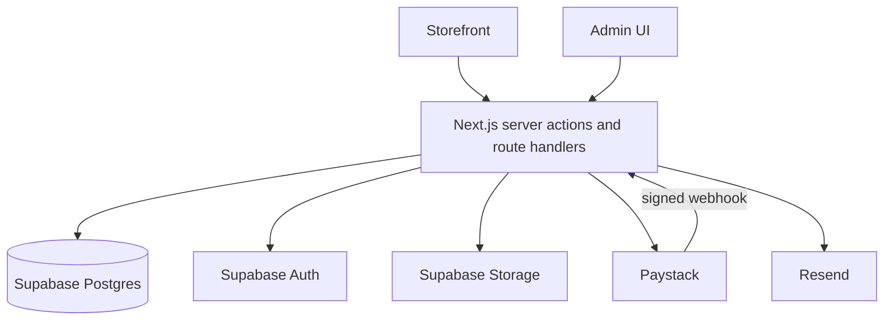

# Nyarko's Hub technical specification

Version 1.0 · 26 November 2026  
Companion to [PRD.md](PRD.md) and [UI-UX.md](UI-UX.md)

## Current system

The prototype is a Next.js App Router site on Vercel.

- Catalogue is static in `src/lib/data.ts`
- Images are in `public/products/`
- Routes: `/`, `/shop`, `/shop/[category]`, `/cart`, `/account`
- No database, auth, payments, or admin API
- Currency formatting is GHS

The commerce work replaces the static catalogue with Supabase and keeps the same visual components.

## Architecture

The browser never decides that a payment succeeded and never writes stock directly. Server code checks the user, validates input, and uses the database.

## Environments

| Name | Use |
| --- | --- |
| local | Developer machine |
| preview | Vercel preview for each branch |
| production | nyarkos-hub.vercel.app, then the client domain |

Secrets live in Vercel and `.env.local`. Never commit them.

Required later:

- `NEXT_PUBLIC_SUPABASE_URL`
- `NEXT_PUBLIC_SUPABASE_ANON_KEY`
- `SUPABASE_SERVICE_ROLE_KEY`
- `PAYSTACK_SECRET_KEY`
- `PAYSTACK_PUBLIC_KEY`
- `RESEND_API_KEY`
- `NEXT_PUBLIC_SITE_URL`

## Data model

Money is stored as integer pesewas. GHS 420.00 is `42000`. Display uses `formatPrice`.

### Catalogue

`categories` — id, parent_id, name, slug, description, image_path, sort_order, active

`collections` — id, name, slug, description, kind (`new`, `bestseller`, `trending`, `sale`, `featured`, `custom`)

`products` — id, name, slug, description, status (`draft`, `published`, `archived`), currency, material, care, size_guide, seo_title, seo_description, created_at, updated_at

`product_categories` and `product_collections` — many-to-many

`product_images` — id, product_id, path, alt, sort_order

`product_variants` — id, product_id, sku unique, colour_name, colour_hex, size, price_pesewas, compare_at_pesewas, active

`inventory` — variant_id primary key, quantity, reserved, low_stock_threshold

`inventory_movements` — id, variant_id, delta, reason (`sale`, `cancel`, `adjust`, `restock`), order_id nullable, actor_id, note, created_at

Available to sell is `quantity - reserved`.

### Commerce

`carts` — id, user_id nullable, guest_token nullable, status (`open`, `converted`, `abandoned`), updated_at

`cart_items` — id, cart_id, variant_id, quantity. Unique on cart plus variant.

`orders` — id, reference unique, user_id nullable, email, phone, status (`pending`, `confirmed`, `processing`, `dispatched`, `delivered`, `cancelled`), payment_status, currency, subtotal, discount, shipping, total, address snapshot JSON, notes, created_at

`order_items` — id, order_id, variant_id, product_name, sku, unit_price, quantity. Prices are copied onto the line so later catalogue edits do not rewrite history.

`payments` — id, order_id, provider, reference unique, amount, status, raw_event JSON, created_at

`refunds` — id, payment_id, amount, status, reason

`shipping_methods` — id, name, zone, price_pesewas, free_over_pesewas nullable, estimate_text, active

`shipments` — id, order_id, method_id, tracking_number, status, shipped_at, delivered_at

`coupons` — id, code unique, type (`percent`, `fixed`, `free_shipping`), value, starts_at, ends_at, usage_limit, min_subtotal, max_discount nullable

### Customers and staff

Supabase Auth holds credentials. `profiles` holds id, role (`customer`, `staff`), full_name, phone.

`addresses` — id, user_id, region, city, line, instructions, is_default

`staff_permissions` — user_id, permission. Permissions are strings such as `products.write` and `orders.refund`.

`audit_logs` — id, actor_id, action, entity, entity_id, created_at

`wishlists` and `wishlist_items` for signed-in customers. Guests use local storage until they sign in, then the server merges.

`reviews` — id, product_id, user_id, order_item_id, rating, body, status (`pending`, `published`, `rejected`)

`newsletter_subscribers` — email unique, consented_at

`support_tickets` — id, order_id nullable, email, topic, body, status

## Critical transactions

**Place order**

1. Re-read variant prices and available stock inside a transaction.
2. Reject the request if any line is short.
3. Insert the order as `pending` / `unpaid`.
4. Reserve stock by increasing `reserved`.
5. Create the payment row.
6. Return the Paystack initialization payload.

**Confirm payment**

1. Verify the Paystack signature.
2. Ignore a reference that is already `successful`.
3. Confirm the amount matches the order total.
4. Mark the payment successful and the order confirmed.
5. Convert reserved units into a permanent stock reduction and write movements.
6. Send the confirmation email once.

**Failed or abandoned payment**

Leave the order unpaid. Release the reservation after the payment window, or immediately on an explicit failure. Do not send a paid-order email.

**Cancel a paid order**

Restore stock, record the movement, create the refund row, and email the customer after the provider accepts the refund.

## Server interfaces

Use route handlers under `src/app/api` for webhooks and server actions for shopper and admin forms.

| Action | Who | Behaviour |
| --- | --- | --- |
| `GET /api/products` | Public | Published products, filters, sort, page |
| `GET /api/products/[slug]` | Public | Product, images, variants, available stock |
| Cart actions | Shopper | Add, update, remove. Reject quantities above available stock |
| `POST /api/checkout` | Shopper | Validate cart, create pending order, start payment |
| `POST /api/webhooks/paystack` | Paystack | Verify signature, update payment and stock |
| `GET /api/orders/[reference]` | Owner or guest with phone match | Tracking view |
| Admin product actions | `products.write` | Create and edit catalogue |
| Admin inventory action | `inventory.write` | Adjust stock and write a movement |
| Admin order action | `orders.write` | Status, tracking, cancel |
| Admin refund action | `orders.refund` | Refund through Paystack |
| `POST /api/newsletter` | Public | Store consent |

Public product reads can be server components querying Supabase with the anon key and row policies. Mutations go through server code that uses the user session.

## Row policies

- Anyone can read published products, active variants, and category content.
- Customers read and write only their own profile, addresses, carts, and wishlists.
- Customers read only their own orders.
- Stock quantities exposed to the shopper are availability, not the warehouse count.
- Staff access is checked in server code against `staff_permissions`. The service role key stays on the server.

## Search

PostgreSQL full text on product name, description, and tags. Filters are SQL predicates on category, price, size, colour, and `quantity > reserved`. Sort popularity by paid units sold.

## Media

Upload to the `product-images` bucket. Store the path, not a permanent public URL, if the bucket is private. The storefront uses Next Image with signed or public URLs. Generate alt text in the admin form. It is required before publish.

## Email

Resend templates: order confirmed, payment failed, dispatched, delivered, refunded. Each send is recorded so a webhook retry does not email twice.

## SEO

`generateMetadata` on product and category pages. `app/sitemap.ts` and `app/robots.ts`. Product JSON-LD with name, image, sku, price, and availability.

## What stays in the prototype until the database exists

`src/lib/data.ts` remains the seed source for the six polos. A seed script inserts those rows, variants, prices, and images so the live catalogue does not disappear during the cutover.

## Out of scope for the first commerce release

Native apps, AI styling, visual search, loyalty points, gift cards, multi-vendor payouts, and automated customs.
